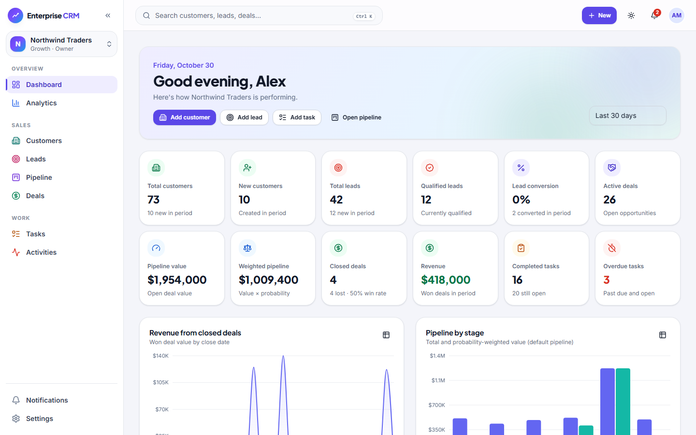

# Enterprise SaaS CRM

A multi-tenant customer relationship management platform for sales teams: customers, leads, a drag-and-drop pipeline, tasks, activity timelines, notifications, analytics, team roles and simulated subscription plans. Built entirely with free, open-source software.



## Features

| Area | Highlights |
| --- | --- |
| Tenancy | Independent workspaces, membership-checked on every request, tenant isolation covered by automated tests |
| Auth | Registration, login/logout, server-side sessions (HttpOnly cookies), email verification, password reset, session management, account lockout, rate limiting, CSRF protection, Argon2id |
| Teams | Invitations by email, acceptance flow, role changes, member removal, ownership transfer, workspace switching |
| Roles | Owner, Admin, Manager, Sales Representative, Viewer - enforced server-side |
| Customers | CRUD, search, filters, sorting, pagination, archive/restore, notes, timelines, CSV import/export (formula-injection safe), duplicate detection |
| Leads | Status, priority, source, follow-ups, assignment, transactional conversion to customer (+ optional deal) with double-conversion protection |
| Pipeline | Multiple pipelines, stage management, Kanban drag-and-drop with optimistic updates and rollback, weighted forecasting |
| Tasks and activities | Assignments, due dates, overdue tracking, comments, calls/emails/meetings/notes/follow-ups |
| Analytics | KPIs, revenue, acquisition, conversion, pipeline, activity and team-performance charts from live SQL, with date ranges |
| Notifications | In-app centre, read/unread, preferences, email via Mailpit, background reminders (BullMQ) |
| Plans | Free / Starter / Growth / Enterprise with limits, feature gates and usage dashboard. Billing is simulated - no payment is ever collected |
| Design | Original design system: layered canvas/surfaces, colour-coded status pills, collapsible sidebar, quick-create menu, animated Kanban, chevron stage tracker, light and dark themes, reduced-motion support ([details](docs/design-system.md)) |
| Ops | Swagger/OpenAPI, structured logs (pino), Prometheus metrics, health checks, Docker Compose, GitHub Actions CI |

## Tech stack

Next.js 15, React 19, TypeScript (strict), Tailwind CSS 4, Radix UI (shadcn-style components), Motion (animations), TanStack Query, React Hook Form, Zod, Recharts, dnd-kit, NestJS 11, Prisma 6, PostgreSQL 16, Redis 7, BullMQ, Nodemailer + Mailpit, Jest, Supertest, Vitest, Playwright, pnpm workspaces.

```
apps/
  api/        NestJS REST API (auth, users, workspaces, customers, leads, pipelines, deals,
              tasks, activities, notifications, analytics, subscriptions, audit-logs)
  web/        Next.js App Router frontend + Playwright E2E tests
packages/
  shared/     Zod schemas, enums, permissions, plan definitions and API types used by both apps
infrastructure/  Dockerfiles, Prometheus/Grafana provisioning
docs/         Architecture, database, API, security, testing and deployment documentation
```

## Quick start with Docker (recommended)

Requires Docker Desktop (free for personal use and small businesses) or Docker Engine.

```bash
cp .env.example .env        # then set POSTGRES_PASSWORD and SESSION_SECRET
docker compose up --build
```

- App: http://localhost:3000
- API + Swagger: http://localhost:4000/api/docs
- Mailpit (password resets, invitations): http://localhost:8025

Optional demo data (two workspaces, six role accounts sharing `SEED_PASSWORD`):

```bash
docker compose --profile seed run --rm seed
```

Optional monitoring (Prometheus :9090, Grafana :3001): `docker compose --profile monitoring up -d`

Stop with `docker compose down` (data persists in named volumes; `docker compose down -v` deletes it).

## Running without Docker

Requires Node.js 22+, pnpm 10, PostgreSQL 16, and optionally Redis 7 and Mailpit.

```bash
pnpm install
cp .env.example apps/api/.env      # use the "without Docker" section and fill in values
pnpm build:shared
pnpm db:deploy                     # apply migrations
pnpm db:seed                       # optional demo data
pnpm dev                           # API on :4000, web on :3000
```

Without `REDIS_URL` the API runs background jobs in-process and keeps rate limits in memory. `scripts/wsl-infra.sh` runs PostgreSQL and Redis from Ubuntu packages inside WSL without root (how this project was developed on Windows without Docker).

## Testing

```bash
pnpm test:unit            # shared (Vitest), API (Jest), web (Vitest)
pnpm test:integration     # API + real PostgreSQL (TEST_DATABASE_URL; database name must contain "test")
pnpm test:e2e             # Playwright against a running stack (web :3000, Mailpit :8025)
pnpm typecheck && pnpm lint
```

See [docs/testing-report.md](docs/testing-report.md) for the latest results.

## Documentation

- [Architecture](docs/architecture.md)
- [Design system](docs/design-system.md)
- [Database schema](docs/database-schema.md)
- [API documentation](docs/api-documentation.md)
- [Security](docs/security.md)
- [Testing report](docs/testing-report.md)
- [Deployment and free hosting](docs/deployment.md)

## License

[MIT](LICENSE)
